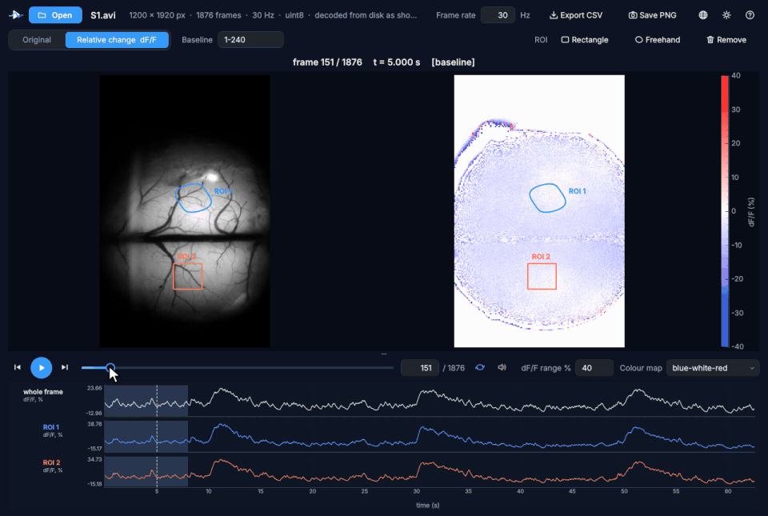
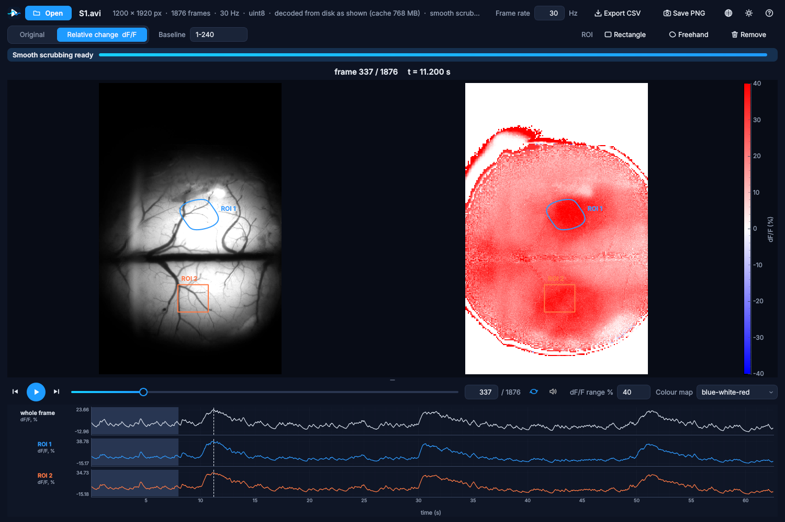

  

<h1 align="center">SciPlayer</h1>

  <b>The video player for looking closely.</b> 
  Drag through any recording, of any size, and every frame follows smoothly, at full resolution. 
  Step frame by frame, see what changed, and measure it. 
  Known in Chinese as <b>盯帧王中王</b>, the king of frame-watchers.

  
  
  

  <b>English</b> · <a href="README.zh-CN.md">简体中文</a> · <a href="README.zh-TW.md">繁體中文</a>

   
  A real widefield fluorescence recording (1200 × 1920 px, 1876 frames at 30 Hz), dragged through two stimulation responses: the frame, its relative change and the traces of two regions follow every frame.

---

## Why SciPlayer?

Ordinary video players are made for watching. When you **study** a recording, you go back and
forth over the same seconds, frame by frame, looking for the moment something starts. That is
where they struggle: dragging the slider jumps between key frames, large files take minutes to
open or do not open at all, and a small change is easy to miss.

SciPlayer is made for that kind of looking.

| | Ordinary players | SciPlayer |
|---|:---:|:---:|
| Smooth dragging through **every** frame, not just key frames | rarely | ✓ |
| Very large recordings (tens of GB, uncompressed) open at once and scrub smoothly | rarely | ✓ |
| Exact frame-by-frame stepping, forward **and back** | some | ✓ |
| Frame number and time always shown | some | ✓ |
| Relative change (dF/F) against frames you choose | ✗ | ✓ |
| Regions of interest with their traces over time | ✗ | ✓ |
| Export traces (CSV) and views (PNG) | ✗ | ✓ |
| Zoom at the mouse, original and relative change together | ✗ | ✓ |

## Who is it for?

Anyone who needs to see **exactly when and where** something happens in a video:

* 🧠 **Life sciences**: calcium and widefield imaging, functional ultrasound, time-lapse
  microscopy, behaviour and long-term monitoring videos.
* ⚙️ **Engineering and materials**: high-speed camera footage, fatigue and crack tests, sprays,
  flows, welding, process monitoring.
* 🏃 **Sports and movement**: technique and biomechanics, frame by frame.
* 🎓 **Teaching and study**: show a process step by step, and let students measure it.
* 🎬 Or simply anyone who wants a player that steps through frames properly.

## Get started in a minute

1. Download **`SciPlayer-<version>-Setup-x64.exe`** from
   [the latest release](https://github.com/HaoChen72/SciPlayer---An-easy-to-use-video-player-for-frame-by-frame-science-exploration/releases/latest).
2. Run it. It needs nothing else (no Python, no MATLAB) and no administrator rights if you choose
   *Install just for me*. *(The installer is not code-signed yet, so Windows may show "Windows protected
   your PC": click **More info**, then **Run anyway**.)*
3. Double-click a video, or drop it on the window. Drag the slider. That's it.

## Features

**Opens anything, instantly.** AVI, MP4, MOV, MKV, WMV, MPEG, WebM, MJPEG, uncompressed video,
multi-page TIFF stacks and MATLAB files. Even an 18.6 GB uncompressed recording shows its first
frame in about a tenth of a second and plays straight away, at its own frame rate, with sound.

**Smooth scrubbing at any size.** While you already watch, SciPlayer prepares the recording in
the background, and a progress bar shows how long that takes. Recordings that fit in memory are
read into it; larger ones get a light "scrubbing copy" for dragging, and the exact,
full-resolution frame takes its place as soon as you stop. Playing and stepping help the
preparation along.

**See the change.** The *relative change* view shows, beside the original, (frame − F0) / F0 in %,
with F0 the mean of baseline frames you choose. Pick the colour range and map. Small, slow or
brief changes stand out at once.

**Measure it.** Draw rectangles or freehand regions. Each gets a trace over time, under the
video, next to the whole frame's. Click a trace to jump to that moment. Export everything as CSV,
or save the view as PNG.

**Look closer.** Ctrl + mouse wheel zooms at the mouse, in both panels at once. Drag to move
around, double-click to see the whole frame again. Even 4000 × 3000 frames play smoothly in the
relative-change view.

**Feels like a modern app.** Dark and light themes, English, 简体中文 and 繁體中文, a draggable
split between video and traces, and file associations so a double-click opens your recordings.

  

## Keyboard and mouse

| Action | How |
|---|---|
| One frame back / forward | ← / → (Shift: 10 frames) |
| Scroll through frames | Mouse wheel |
| Zoom at the mouse | Ctrl + mouse wheel |
| Whole frame again | Double-click, or Ctrl + 0 |
| Play / pause | Space |
| First / last frame | Home / End |
| Jump to a moment | Click a trace |
| Open a file | Ctrl + O, or drop it on the window |
| Cancel drawing a region | Esc or right-click |

## Two editions

| | |
|---|---|
| [**SciPlayer for Windows**](windows/) (1.3.5) | The installable app described here. Python source (PySide6, pyqtgraph, PyAV/FFmpeg), built into a self-contained installer. The [Windows README](windows/README.md) explains how it works and how to build it. |
| [**SciPlayer for MATLAB**](sciplayer.m) (0.2.0) | One file, base MATLAB only, scriptable from your own code. See [README_MATLAB.md](README_MATLAB.md). |

## FAQ

**Is it free?** Yes, for any non-commercial use: research, teaching, study, personal use, and use
by charitable, educational, public research and government organisations. For commercial use,
please get in touch (open an issue).

**macOS or Linux?** The installer is for Windows 11 (64-bit). The MATLAB edition runs wherever
MATLAB does. The Windows app's Python source also runs on Linux with its dependencies installed
(its tests run there); macOS has not been tried yet.

**Does it change my files?** Never. SciPlayer only reads them.

**Is the scrubbing copy used for measurements?** No. Traces, relative change values, ROI means and
exports always come from the exact frames.

## Ideas for what comes next

* A **change trace**: how much each frame differs from the one before, so that peaks point to
  where something happened in a long recording.
* A macOS build.
* Calibrated distances and angles, side-by-side comparison of two recordings.

Tell us what you need in [Issues](https://github.com/HaoChen72/SciPlayer---An-easy-to-use-video-player-for-frame-by-frame-science-exploration/issues).
Bug reports and ideas are very welcome.

## Licence

SciPlayer is free for non-commercial use under the
[PolyForm Noncommercial License 1.0.0](LICENSE.md). Commercial use needs a separate licence from
the author. The Windows installer also contains open-source components (Python, Qt, FFmpeg,
NumPy and others), each under its own licence, listed in [windows/LICENSES.txt](windows/LICENSES.txt).

## Cite

If SciPlayer helps your work, please cite it: GitHub's **Cite this repository** button (from
[CITATION.cff](CITATION.cff)) gives the reference.

## Acknowledgements

SciPlayer stands on excellent open-source work: [Qt / PySide6](https://www.qt.io/qt-for-python),
[pyqtgraph](https://www.pyqtgraph.org/), [FFmpeg](https://ffmpeg.org/) and
[PyAV](https://github.com/PyAV-Org/PyAV), [NumPy](https://numpy.org/), [SciPy](https://scipy.org/),
[tifffile](https://github.com/cgohlke/tifffile), [h5py](https://www.h5py.org/),
[Pillow](https://python-pillow.org/), [python-sounddevice](https://github.com/spatialaudio/python-sounddevice)
and [conda-forge](https://conda-forge.org/).

 ⭐ <b>If SciPlayer saves you time, a star helps others find it.</b> ⭐

