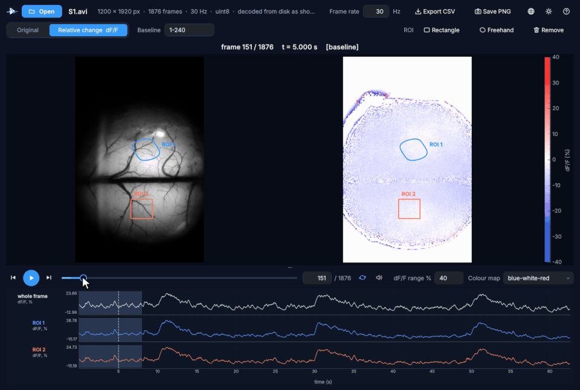
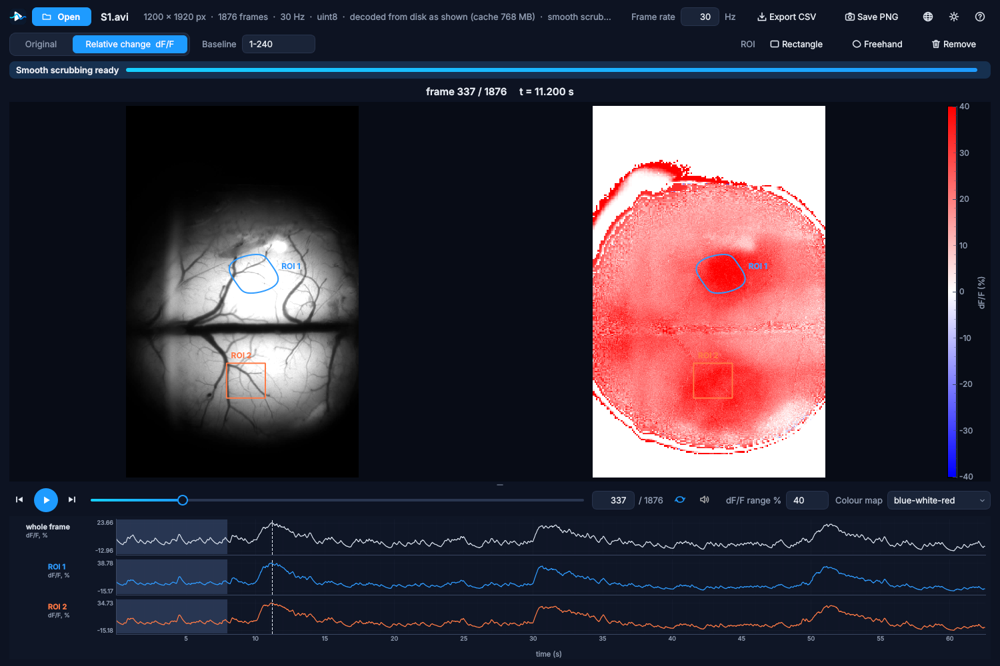

  

<h1 align="center">SciPlayer</h1>

  <b>为细看而生的视频播放器。</b> 
  无论录像多大，拖动进度条，每一帧都流畅跟随，全分辨率。 
  逐帧查看，看清变化，并加以测量。

  
  
  

  <a href="README.md">English</a> · <b>简体中文</b> · <a href="README.zh-TW.md">繁體中文</a>

   
  一段真实的宽场荧光录像（1200 × 1920 像素，1876 帧，30 Hz），拖动浏览两次刺激响应：原始画面、相对变化与两个区域的曲线逐帧跟随。

---

## 为什么选择 SciPlayer？

普通播放器是为“观看”设计的。而当你要**研究**一段录像时，你会在同几秒内来回反复、逐帧查找某件事开始的那一刻。这正是普通播放器的短板：拖动进度条只在关键帧之间跳动，大文件要打开很久甚至打不开，细微的变化很容易漏掉。

SciPlayer 正是为这种“细看”而设计的。

| | 普通播放器 | SciPlayer |
|---|:---:|:---:|
| 拖动时流畅显示**每一帧**，而不只是关键帧 | 很少 | ✓ |
| 超大录像（数十 GB、未压缩）立即打开并流畅拖动 | 很少 | ✓ |
| 精确逐帧前进与**后退** | 部分 | ✓ |
| 始终显示帧号与时间 | 部分 | ✓ |
| 相对于自选基线帧的相对变化（dF/F） | ✗ | ✓ |
| 感兴趣区域（ROI）及其随时间变化的曲线 | ✗ | ✓ |
| 导出曲线（CSV）与画面（PNG） | ✗ | ✓ |
| 以鼠标处为中心缩放，原始画面与相对变化同步 | ✗ | ✓ |

## 适合谁？

任何需要看清某件事**何时、何处**发生的人：

* 🧠 **生命科学**：钙成像与宽场成像、功能超声、延时显微成像、行为学与长时间监测视频。
* ⚙️ **工程与材料**：高速摄像、疲劳与裂纹试验、喷雾、流动、焊接、过程监测。
* 🏃 **运动与动作分析**：逐帧分析技术动作与生物力学。
* 🎓 **教学与学习**：一步一步展示过程，并让学生动手测量。
* 🎬 以及所有想要一个真正能逐帧查看的播放器的人。

## 一分钟上手

1. 从[最新版本](https://github.com/HaoChen72/SciPlayer---An-easy-to-use-video-player-for-frame-by-frame-science-investigation/releases/latest)下载 **`SciPlayer-<版本>-Setup-x64.exe`**。
2. 运行安装程序。无需安装任何其他软件（不需要 Python，也不需要 MATLAB）；选择“只为我自己安装”时无需管理员权限。*（安装程序暂未进行代码签名，Windows 可能提示“Windows 已保护你的电脑”：点击**更多信息**，再点击**仍要运行**。）*
3. 双击视频文件，或把它拖到窗口中，然后拖动进度条。就这么简单。

## 功能

**什么都能打开，立即打开。** AVI、MP4、MOV、MKV、WMV、MPEG、WebM、MJPEG、未压缩视频、多页 TIFF 图像栈以及 MATLAB 文件。即使是 18.6 GB 的未压缩录像，也能在约十分之一秒内显示第一帧，并立即以其自身帧率播放，并带有声音。

**任意大小都能流畅拖动。** 在你观看的同时，SciPlayer 在后台为录像做准备，进度条会显示还需要多久。能放进内存的录像会被读入内存；更大的录像会生成一份轻量的“拖动副本”用于拖动，一旦停下，精确的全分辨率帧会立即替换它。播放与逐帧查看也会帮助加快准备。

**看清变化。** “相对变化”视图在原始画面旁显示 (帧 − F0) / F0（%），F0 为你选择的基线帧的平均值。可自选颜色范围与色图。细微、缓慢或短暂的变化一目了然。

**加以测量。** 用鼠标画出矩形或自由形状的区域，每个区域都会在视频下方显示一条随时间变化的曲线，与整帧的曲线并列。点击曲线即可跳到那一刻。所有曲线可导出为 CSV，画面可保存为 PNG。

**凑近细看。** Ctrl + 鼠标滚轮以鼠标所指处为中心缩放，两个画面同步。拖动可移动画面，双击即回到整帧。即使是 4000 × 3000 的画面，在相对变化视图中也能流畅播放。

**现代化的界面。** 深色与浅色主题，English、简体中文与繁體中文界面，可拖动调整视频与曲线之间的分界，并关联文件类型，双击即可打开录像。

  

## 键盘与鼠标

| 操作 | 方法 |
|---|---|
| 后退 / 前进一帧 | ← / →（Shift：10 帧） |
| 逐帧滚动 | 鼠标滚轮 |
| 以鼠标处为中心缩放 | Ctrl + 鼠标滚轮 |
| 回到整帧 | 双击，或 Ctrl + 0 |
| 播放 / 暂停 | 空格 |
| 第一帧 / 最后一帧 | Home / End |
| 跳到某一时刻 | 点击曲线 |
| 打开文件 | Ctrl + O，或拖入窗口 |
| 取消绘制区域 | Esc 或右键 |

## 两个版本

| | |
|---|---|
| [**SciPlayer for Windows**](windows/)（1.3.5） | 本页介绍的可安装应用。Python 源代码（PySide6、pyqtgraph、PyAV/FFmpeg），打包为自带运行环境的安装程序。其[说明文档](windows/README.md)介绍工作原理与构建方法。 |
| [**SciPlayer for MATLAB**](sciplayer.m)（0.2.0） | 单个文件，仅需基础 MATLAB，可在你自己的代码中调用。见 [README_MATLAB.md](README_MATLAB.md)。 |

## 常见问题

**免费吗？** 是的，任何非商业用途均免费：科研、教学、学习、个人使用，以及慈善、教育、公共科研与政府机构的使用。如需商业使用，请联系作者（在 Issues 中留言）。

**支持 macOS 或 Linux 吗？** 安装程序适用于 Windows 11（64 位）。MATLAB 版本可在任何支持 MATLAB 的系统上运行。Windows 版的 Python 源代码在安装依赖后也可在 Linux 上运行（其测试就在 Linux 上进行）；macOS 尚未测试。

**会修改我的文件吗？** 绝不会。SciPlayer 只读取文件。

**拖动副本会用于测量吗？** 不会。曲线、相对变化数值、ROI 均值与导出结果始终来自精确的原始帧。

## 后续设想

* **变化曲线**：显示每一帧与前一帧的差异，让峰值直接指出长录像中发生事件的位置。
* macOS 版本。
* 标定后的距离与角度测量、两段录像并排对比。

欢迎在 [Issues](https://github.com/HaoChen72/SciPlayer---An-easy-to-use-video-player-for-frame-by-frame-science-investigation/issues) 中告诉我们你的需求，也非常欢迎反馈问题与建议。

## 许可

SciPlayer 依据 [PolyForm Noncommercial License 1.0.0](LICENSE.md) 供非商业用途免费使用。商业使用需另行获得作者许可。Windows 安装程序还包含开源组件（Python、Qt、FFmpeg、NumPy 等），各自遵循其许可，列于 [windows/LICENSES.txt](windows/LICENSES.txt)。

## 引用

如果 SciPlayer 对你的工作有帮助，欢迎引用：GitHub 页面上的 **Cite this repository** 按钮（依据 [CITATION.cff](CITATION.cff)）会给出引用格式。

## 致谢

SciPlayer 建立在优秀的开源项目之上：[Qt / PySide6](https://www.qt.io/qt-for-python)、[pyqtgraph](https://www.pyqtgraph.org/)、[FFmpeg](https://ffmpeg.org/) 与 [PyAV](https://github.com/PyAV-Org/PyAV)、[NumPy](https://numpy.org/)、[SciPy](https://scipy.org/)、[tifffile](https://github.com/cgohlke/tifffile)、[h5py](https://www.h5py.org/)、[Pillow](https://python-pillow.org/)、[python-sounddevice](https://github.com/spatialaudio/python-sounddevice) 以及 [conda-forge](https://conda-forge.org/)。

 ⭐ <b>如果 SciPlayer 为你节省了时间，点个 Star 能帮助更多人发现它。</b> ⭐

