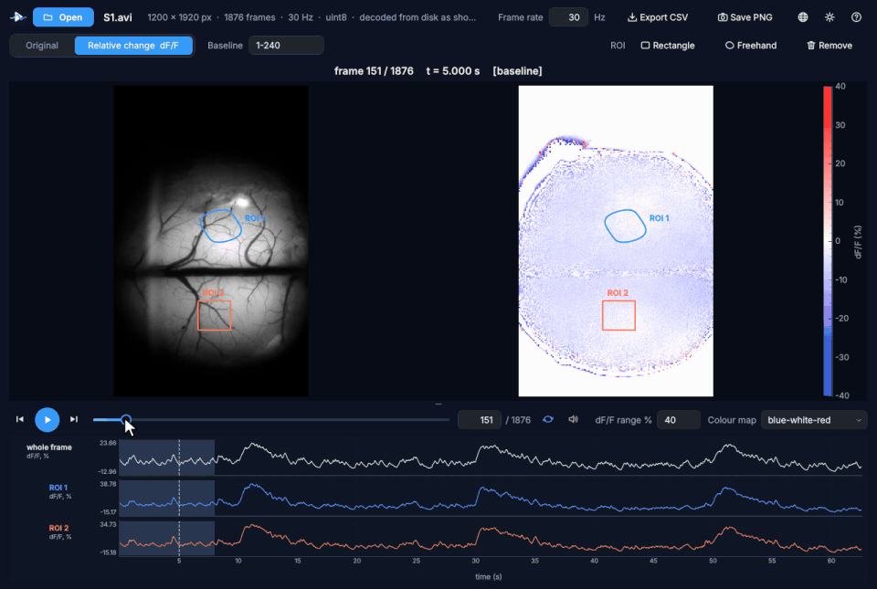
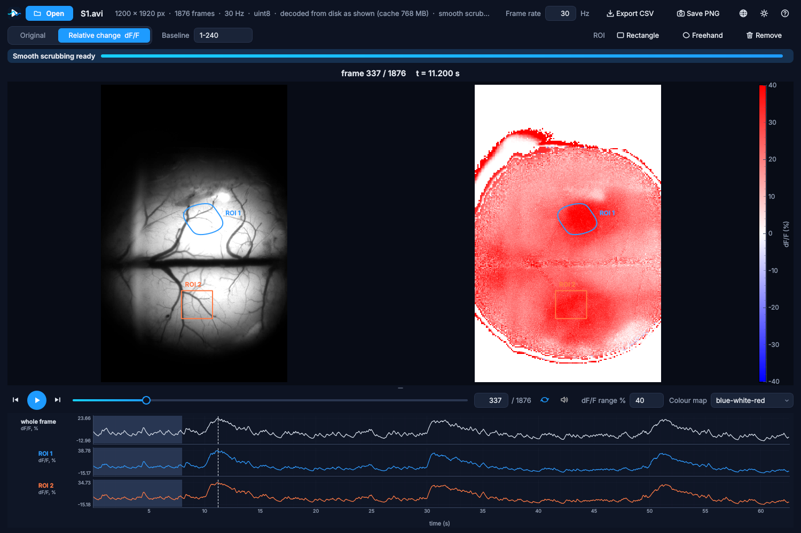

  

<h1 align="center">SciPlayer</h1>

  <b>為細看而生的影片播放器。</b> 
  無論錄影多大，拖曳進度列，每一格都流暢跟隨，全解析度。 
  逐格檢視，看清變化，並加以量測。

  
  
  

  <a href="README.md">English</a> · <a href="README.zh-CN.md">简体中文</a> · <b>繁體中文</b>

   
  一段真實的寬視野螢光錄影（1200 × 1920 像素，1876 格，30 Hz），拖曳瀏覽兩次刺激反應：原始畫面、相對變化與兩個區域的曲線逐格跟隨。

---

## 為什麼選擇 SciPlayer？

一般播放器是為「觀看」設計的。而當你要**研究**一段錄影時，你會在同樣幾秒內來回反覆、逐格尋找某件事開始的那一刻。這正是一般播放器的弱點：拖曳進度列只在關鍵畫格之間跳動，大型檔案要開啟很久甚至無法開啟，細微的變化很容易錯過。

SciPlayer 正是為這種「細看」而設計的。

| | 一般播放器 | SciPlayer |
|---|:---:|:---:|
| 拖曳時流暢顯示**每一格**，而不只是關鍵畫格 | 很少 | ✓ |
| 超大錄影（數十 GB、未壓縮）立即開啟並流暢拖曳 | 很少 | ✓ |
| 精確逐格前進與**後退** | 部分 | ✓ |
| 隨時顯示畫格編號與時間 | 部分 | ✓ |
| 相對於自選基準畫格的相對變化（dF/F） | ✗ | ✓ |
| 感興趣區域（ROI）及其隨時間變化的曲線 | ✗ | ✓ |
| 匯出曲線（CSV）與畫面（PNG） | ✗ | ✓ |
| 以滑鼠所指處為中心縮放，原始畫面與相對變化同步 | ✗ | ✓ |

## 適合誰？

任何需要看清某件事**何時、何處**發生的人：

* 🧠 **生命科學**：鈣離子影像與寬視野影像、功能性超音波、縮時顯微影像、行為與長時間監測影片。
* ⚙️ **工程與材料**：高速攝影、疲勞與裂紋試驗、噴霧、流動、焊接、製程監測。
* 🏃 **運動與動作分析**：逐格分析技術動作與生物力學。
* 🎓 **教學與學習**：一步一步展示過程，並讓學生動手量測。
* 🎬 以及所有想要一個真正能逐格檢視的播放器的人。

## 一分鐘上手

1. 從[最新版本](https://github.com/HaoChen72/SciPlayer---An-easy-to-use-video-player-for-frame-by-frame-science-investigation/releases/latest)下載 **`SciPlayer-<版本>-Setup-x64.exe`**。
2. 執行安裝程式。不需要安裝任何其他軟體（不需要 Python，也不需要 MATLAB）；選擇「僅安裝給自己」時不需要系統管理員權限。*（安裝程式尚未進行程式碼簽章，Windows 可能顯示「Windows 已保護您的電腦」：請按**其他資訊**，再按**仍要執行**。）*
3. 按兩下影片檔，或把它拖到視窗中，然後拖曳進度列。就這麼簡單。

## 功能

**什麼都能開，立即開啟。** AVI、MP4、MOV、MKV、WMV、MPEG、WebM、MJPEG、未壓縮影片、多頁 TIFF 影像堆疊以及 MATLAB 檔案。即使是 18.6 GB 的未壓縮錄影，也能在約十分之一秒內顯示第一格，並立即以其本身的影格率播放，並帶有聲音。

**任何大小都能流暢拖曳。** 在你觀看的同時，SciPlayer 會在背景為錄影做準備，進度列會顯示還需要多久。能放進記憶體的錄影會被讀入記憶體；更大的錄影會產生一份輕量的「拖曳副本」供拖曳使用，一旦停下，精確的全解析度畫格會立即取代它。播放與逐格檢視也會幫助加快準備。

**看清變化。** 「相對變化」檢視會在原始畫面旁顯示 (畫格 − F0) / F0（%），F0 為你選擇的基準畫格的平均值。可自選色彩範圍與色彩對應表。細微、緩慢或短暫的變化一目了然。

**加以量測。** 用滑鼠畫出矩形或手繪區域，每個區域都會在影片下方顯示一條隨時間變化的曲線，與整格的曲線並列。按一下曲線即可跳到那一刻。所有曲線可匯出為 CSV，畫面可儲存為 PNG。

**湊近細看。** Ctrl + 滑鼠滾輪以滑鼠所指處為中心縮放，兩個畫面同步。拖曳可移動畫面，按兩下即回到整格。即使是 4000 × 3000 的畫面，在相對變化檢視中也能流暢播放。

**現代化的介面。** 深色與淺色主題，English、简体中文與繁體中文介面，可拖曳調整影片與曲線之間的分界，並關聯檔案類型，按兩下即可開啟錄影。

  

## 鍵盤與滑鼠

| 操作 | 方法 |
|---|---|
| 後退 / 前進一格 | ← / →（Shift：10 格） |
| 逐格捲動 | 滑鼠滾輪 |
| 以滑鼠處為中心縮放 | Ctrl + 滑鼠滾輪 |
| 回到整格 | 按兩下，或 Ctrl + 0 |
| 播放 / 暫停 | 空白鍵 |
| 第一格 / 最後一格 | Home / End |
| 跳到某一刻 | 按一下曲線 |
| 開啟檔案 | Ctrl + O，或拖入視窗 |
| 取消繪製區域 | Esc 或按右鍵 |

## 兩個版本

| | |
|---|---|
| [**SciPlayer for Windows**](windows/)（1.3.5） | 本頁介紹的可安裝應用程式。Python 原始碼（PySide6、pyqtgraph、PyAV/FFmpeg），封裝為自帶執行環境的安裝程式。其[說明文件](windows/README.md)介紹運作原理與建置方式。 |
| [**SciPlayer for MATLAB**](sciplayer.m)（0.2.0） | 單一檔案，只需基本 MATLAB，可在你自己的程式中呼叫。請見 [README_MATLAB.md](README_MATLAB.md)。 |

## 常見問題

**免費嗎？** 是的，任何非商業用途皆免費：研究、教學、學習、個人使用，以及慈善、教育、公共研究與政府機構的使用。如需商業使用，請與作者聯絡（在 Issues 中留言）。

**支援 macOS 或 Linux 嗎？** 安裝程式適用於 Windows 11（64 位元）。MATLAB 版本可在任何支援 MATLAB 的系統上執行。Windows 版的 Python 原始碼在安裝相依套件後也可在 Linux 上執行（其測試就在 Linux 上進行）；macOS 尚未測試。

**會修改我的檔案嗎？** 絕不會。SciPlayer 只會讀取檔案。

**拖曳副本會用於量測嗎？** 不會。曲線、相對變化數值、ROI 平均值與匯出結果一律來自精確的原始畫格。

## 後續構想

* **變化曲線**：顯示每一格與前一格的差異，讓峰值直接指出長時間錄影中發生事件的位置。
* macOS 版本。
* 經校正的距離與角度量測、兩段錄影並排比較。

歡迎在 [Issues](https://github.com/HaoChen72/SciPlayer---An-easy-to-use-video-player-for-frame-by-frame-science-investigation/issues) 中告訴我們你的需求，也非常歡迎回報問題與提供建議。

## 授權

SciPlayer 依據 [PolyForm Noncommercial License 1.0.0](LICENSE.md) 供非商業用途免費使用。商業使用需另行取得作者授權。Windows 安裝程式還包含開放原始碼元件（Python、Qt、FFmpeg、NumPy 等），各自遵循其授權，列於 [windows/LICENSES.txt](windows/LICENSES.txt)。

## 引用

如果 SciPlayer 對你的工作有幫助，歡迎引用：GitHub 頁面上的 **Cite this repository** 按鈕（依據 [CITATION.cff](CITATION.cff)）會提供引用格式。

## 致謝

SciPlayer 建立在優秀的開放原始碼專案之上：[Qt / PySide6](https://www.qt.io/qt-for-python)、[pyqtgraph](https://www.pyqtgraph.org/)、[FFmpeg](https://ffmpeg.org/) 與 [PyAV](https://github.com/PyAV-Org/PyAV)、[NumPy](https://numpy.org/)、[SciPy](https://scipy.org/)、[tifffile](https://github.com/cgohlke/tifffile)、[h5py](https://www.h5py.org/)、[Pillow](https://python-pillow.org/)、[python-sounddevice](https://github.com/spatialaudio/python-sounddevice) 以及 [conda-forge](https://conda-forge.org/)。

 ⭐ <b>如果 SciPlayer 為你節省了時間，給個 Star 能幫助更多人發現它。</b> ⭐

